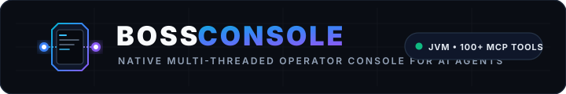

<p align="center">
  
</p>

<p align="center">
  <strong>Native Multi-Threaded Operator's Console &amp; Autonomous Agent Harness for Frontier AI Systems</strong>
</p>

<p align="center">
  <a href="https://www.linkedin.com/in/akashjadon"></a>
  <a href="https://github.com/akashjadon04"></a>
  
  
  
</p>

---

## ⚡ Executive Summary

Most agentic desktop workspaces and coding environments—including Claude Desktop, Cursor, Windsurf, and VS Code forks—are built on **Electron**, binding AI agents to a single-threaded JavaScript event loop with heavy memory overhead, rigid sandboxes, and zero runtime hot-reloading.

**BossConsole** (BOSS) is a high-performance, multi-threaded operator console engineered from the ground up on **Kotlin Multiplatform and the Java Virtual Machine (JVM)**. Built for enterprise engineers, autonomous agents, and scientific researchers, BossConsole provides a native desktop environment capable of running Claude Code, OpenAI Codex, Google Gemini, and OpenCode with direct access to:

1. **Embedded Chromium Browser Engine (Fluck)**: Real browser automation, DOM inspection, and record-and-replay RPA with zero model access to raw credentials.
2. **True JVM Multi-Threading**: Multi-agent parallel execution without UI stutters or IPC serialization bottlenecks.
3. **Live Runtime Plugin Hot-Reload**: Reshape and compile tools on the fly without restarting the application or losing session context.
4. **Governed Model Context Protocol (MCP)**: Over 100 native `mcp__boss__*` endpoints exposing editor buffers, terminals, tabs, git, and local secrets to autonomous agents.
5. **BossTerm Shareable Terminal**: Sub-millisecond PTY terminal sharing with mobile companion devices via instant QR codes.

---

## 🏛️ System Architecture

```mermaid
flowchart TD
    subgraph AgentLayer ["Autonomous AI Agent Drivers"]
        Claude["Claude Code"]
        Codex["OpenAI Codex"]
        Gemini["Google Gemini CLI"]
        OpenCode["OpenCode / Custom Agents"]
    end

    subgraph MCPLayer ["Unified Model Context Protocol (100+ Tools)"]
        TabTools["Tab & Pane Control (mcp__boss__tabs_*)"]
        TermTools["Terminal Stream (mcp__boss__term_*)"]
        BrowserTools["Browser Automation (mcp__boss__browser_*)"]
        SecretTools["Credential Vault (mcp__boss__secrets_*)"]
        GitTools["Repository Intelligence (mcp__boss__git_*)"]
    end

    subgraph CoreEngine ["BossConsole Native JVM Core Engine"]
        JVM["Kotlin Multiplatform / Compose Multiplatform"]
        HotReload["Dynamic Plugin ClassLoader & Runtime Hot-Reload"]
        SecretMgr["Zero-Knowledge Encrypted Secret Vault"]
        ProcessEngine["Native PTY Process Subsystem"]
    end

    subgraph Subsystems ["Integrated Native Subsystems"]
        Fluck["Fluck Embedded Chromium Engine<br/>(DOM, CDP & RPA Automation)"]
        BossTerm["BossTerm Terminal Engine<br/>(QR Code Remote P2P Stream)"]
        Editor["High-Speed Syntax Code Editor"]
    end

    Claude & Codex & Gemini & OpenCode <-->|Stdio / SSE MCP| MCPLayer
    MCPLayer <--> CoreEngine
    CoreEngine <--> Fluck
    CoreEngine <--> BossTerm
    CoreEngine <--> Editor
    CoreEngine <--> HotReload
    SecretMgr -.->|Injected Logins (Hidden from LLM)| Fluck
```

---

## 📊 Architectural Benchmark: BossConsole vs. The Field

| Feature | **BossConsole (BOSS)** | Claude Desktop | Codex App | Google Antigravity | Cursor | Windsurf / Devin |
| :--- | :---: | :---: | :---: | :---: | :---: | :---: |
| **Runtime Architecture** | **Native JVM** | Electron | Electron | Electron | Electron | Electron |
| **Threading Model** | **True Multi-Threaded** | Single-Thread JS | Single-Thread JS | Single-Thread JS | Single-Thread JS | Single-Thread JS |
| **Model Independence** | **Any Agent (Open)** | Anthropic Only | OpenAI Only | Gemini / Multi | Multi-Model | Multi-Model |
| **Runtime Hot-Reload** | **Yes (Zero-Restart)** | No | No | No | No | No |
| **Embedded Browser** | **Yes (Chromium Fluck)** | No | No | Custom Webview | Browser Preview | Browser View |
| **Native MCP Surface** | **100+ Boss Tools** | Basic MCP Client | Proprietary | Built-in MCP | Tools API | Proprietary |
| **Secret Masking** | **Client-Side Vault** | Manual Env | Cloud Stored | Sandbox Env | Local Env | Cloud Stored |
| **License** | **Apache 2.0 (Open)** | Proprietary | Proprietary | Proprietary | Proprietary | Proprietary |

---

## 🧰 The 100+ MCP Tool Directory

BossConsole exposes its entire operating surface to autonomous LLM agents through structured Model Context Protocol endpoints:

### 1. Workspace & Tab Inspection
- `mcp__boss__tabs_list`: Inspect all open panes, terminals, editors, and web tabs.
- `mcp__boss__tabs_create`: Programmatically spin up new workflow spaces.
- `mcp__boss__tabs_focus`: Direct the user or agent attention to specific views.

### 2. Browser Automation (Fluck Engine)
- `mcp__boss__browser_navigate`: Load URLs with complete cookie and session isolation.
- `mcp__boss__browser_run_js`: Execute JavaScript in the page context and extract structured JSON.
- `mcp__boss__browser_screenshot`: Capture full-page visual viewport state for multimodal analysis.
- `mcp__boss__browser_rpa_replay`: Trigger deterministic recorded robotic process automations.

### 3. Terminal & Shell Stream (BossTerm)
- `mcp__boss__term_exec`: Run asynchronous commands in governed PTY sessions.
- `mcp__boss__term_read`: Read terminal buffer outputs and exit codes.
- `mcp__boss__term_share_qr`: Generate peer-to-peer session links for mobile terminal monitoring.

### 4. Enterprise Secret Governance
- `mcp__boss__secrets_get_masked`: Retrieve safe references for input forms without leaking plain-text tokens to model context.
- `mcp__boss__secrets_autofill`: Directly inject credentials into browser auth prompts.

---

## 🚀 Quick Start Guide

### 1. System Requirements
- **Java Development Kit (JDK)**: OpenJDK 17 or later
- **Supported Operating Systems**: macOS (Apple Silicon & Intel), Windows 10/11, Linux (x86_64 & aarch64)

### 2. Build and Run from Source

```bash
# Clone the repository
git clone https://github.com/akashjadon04/BossConsole.git
cd BossConsole

# Launch the desktop console in development mode
./gradlew run
```

### 3. Connecting Your AI Agent

Launch your preferred agent in the terminal with BossConsole's MCP configuration:

```bash
# With Claude Code
claude --mcp-server http://localhost:8765/mcp

# With Google Gemini CLI
gemini agent --mcp-config ./config/mcp-boss.json
```

---

## 📂 Repository Layout

```
BossConsole/
├── assets/
│   └── boss-console-banner.svg     # Architectural branding banner
├── composeApp/                     # JetBrains Compose Multiplatform UI
├── modules/                        # Subsystems (Browser, Terminal, Editor, MCP)
│   ├── browser-fluck/              # Embedded Chromium automation layer
│   ├── bossterm/                   # Multi-platform PTY and QR streaming
│   ├── secret-manager/             # Local AES-GCM credential vault
│   └── mcp-server/                 # 100+ native MCP tool endpoints
├── plugin-platform/                # Dynamic runtime plugin classloaders
├── benchmarks/                     # Speedometer and rendering benchmarks
├── build.gradle.kts                # Root Gradle multi-project build configuration
└── settings.gradle.kts             # Subproject module declarations
```

---

## 👨‍💻 Architected & Developed By

<p align="left">
  <strong>Akash Jadon</strong><br/>
  Principal Systems &amp; Autonomous AI Architect<br/>
  💼 LinkedIn: <a href="https://www.linkedin.com/in/akashjadon">https://www.linkedin.com/in/akashjadon</a><br/>
  🐙 GitHub: <a href="https://github.com/akashjadon04">https://github.com/akashjadon04</a>
</p>

---

## 📄 License

Distributed under the Apache License, Version 2.0. See [LICENSE](LICENSE) for complete terms.
